# Psyykkeri style guide

The target look, voice and components for Psyykkeri: **professional, clear, calm, clinical**.

**Status: target design.** This guide refines what is built today. `style.md` at the repository root describes the current implementation in `src/styles.css`, screen by screen. Where the two differ on looks (colours, depth, type sizes, component styling), this guide is the direction; where `style.md` sets behaviour, layout or content rules (the language-leak rule, no emoji, no hashtags, tooltips for evidence, the map), those still apply unchanged. Move the CSS over one change at a time and update `style.md` in the same change.

Images in `img/` are rendered from the live HTML version of this guide. Text in them is Finnish, the reference language. Patients and identity codes are synthetic.

## Contents

1. [Principles](#1-principles)
2. [Colour](#2-colour)
3. [Typography](#3-typography)
4. [Space, shape and depth](#4-space-shape-and-depth)
5. [Components](#5-components)
6. [Voice and language](#6-voice-and-language)
7. [What changes from the current stylesheet](#7-what-changes-from-the-current-stylesheet)
8. [Rules for agents](#8-rules-for-agents)

## 1. Principles

Clinicians use Psyykkeri between appointments, often with a patient in the room. Every choice serves fast, confident reading under that pressure.

| Word | Means | In practice |
|---|---|---|
| Professional | Looks like a tool from the wellbeing services county, not a consumer app. | One brand colour. Square corners. The doctor cat stays in the top bar and on the login page. |
| Clear | "Which group, where, when, is there room" reads in one glance. | Seven type sizes. Status is always a word plus a shape, never colour alone. |
| Calm | Nothing shouts. Alarm is saved for real errors and safety. | Flat fills, no glow or gloss. A full group is grey, not red. No exclamation marks. |
| Clinical | Precise, neutral and traceable, like a good patient record. | Identifiers in a monospace face. Exact dates, times and distances. One term per concept. |

## 2. Colour

Components use **only role tokens**, never hex values. Every role has a light and a dark value, so a dark theme needs no component changes.

### Tokens

```css
:root {
  /* Surfaces */
  --canvas: #f4f7f6;       /* page background */
  --surface: #ffffff;      /* cards, dialogs, fields */
  --sunken: #eef3f1;       /* disabled fields, dialog footers, table heads */
  --tint: #eef6f3;         /* matched and suggested backgrounds */
  /* Text */
  --ink: #17231f;          /* body text and headings */
  --ink-2: #4a5b56;        /* secondary text */
  --ink-3: #6b7a75;        /* placeholders, metadata; 4.5:1 on white */
  --on-accent: #ffffff;    /* text on --accent */
  /* Lines */
  --line: #d8e2de;         /* dividers, card borders */
  --line-strong: #7c8d87;  /* field and button borders; 3.5:1 on white */
  --focus: #008d70;        /* focus rings */
  /* Brand */
  --accent: #015742;       /* primary buttons, patient banner, selected states */
  --accent-hover: #0a6a53;
  --accent-text: #007a61;  /* green text and links; 5.3:1 on white */
  --accent-soft: #a9d6cb;  /* matched-tag borders, quiet fills */
  --rule: #008d70;         /* top rules, card stripe; never text */
  /* Status */
  --ok: #015742;     --ok-bg: #eef6f3;
  --info: #1d5a85;   --info-bg: #e8f1f8;
  --warn: #7a4f00;   --warn-bg: #fdf3dc;  --warn-line: #d9a63a;
  --danger: #b42318; --danger-bg: #fdecea;
  --scrim: rgb(1 37 28 / 0.4);  /* dialog backdrop */
}

/* Dark values, applied by prefers-color-scheme or [data-theme="dark"] */
:root[data-theme="dark"] {
  --canvas: #0f1614; --surface: #161f1c; --sunken: #121a18; --tint: #13302a;
  --ink: #e3ece9; --ink-2: #a7b6b1; --ink-3: #8b9b96; --on-accent: #08201a;
  --line: #26332f; --line-strong: #64766f; --focus: #5fc3a8;
  --accent: #5fc3a8; --accent-hover: #7fd3bc; --accent-text: #6fcdb3; --accent-soft: #2b5a4e; --rule: #3fa58a;
  --ok: #6fcdb3; --ok-bg: #13302a;
  --info: #8cbfe6; --info-bg: #13222e;
  --warn: #e7c26a; --warn-bg: #2a2210; --warn-line: #9c7a2a;
  --danger: #f19a8f; --danger-bg: #2e1715;
  --scrim: rgb(0 0 0 / 0.55);
  color-scheme: dark;
}
```

### Brand

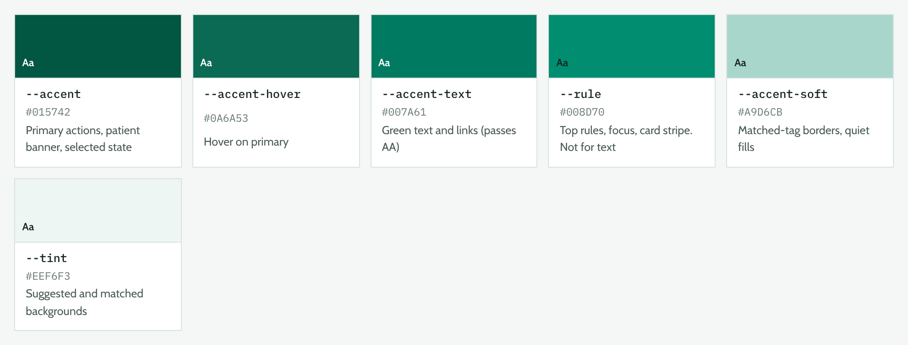

Dark theme:

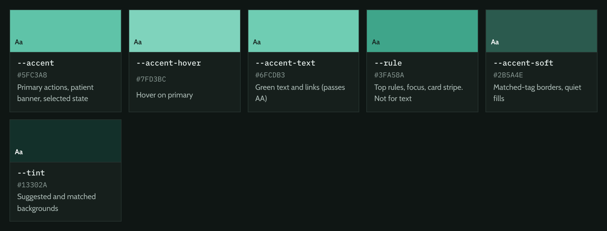

### Neutrals

Every grey leans slightly toward the pine hue.

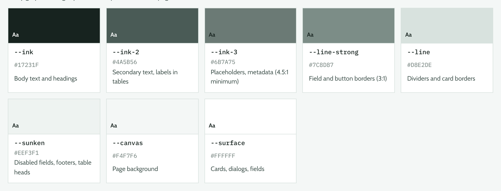

### Status

Status colours are separate from the brand. **Red appears only when the clinician must act:** an invalid personal identity code, a failed booking, a non-disclosure flag (turvakielto). A full group is not an error.

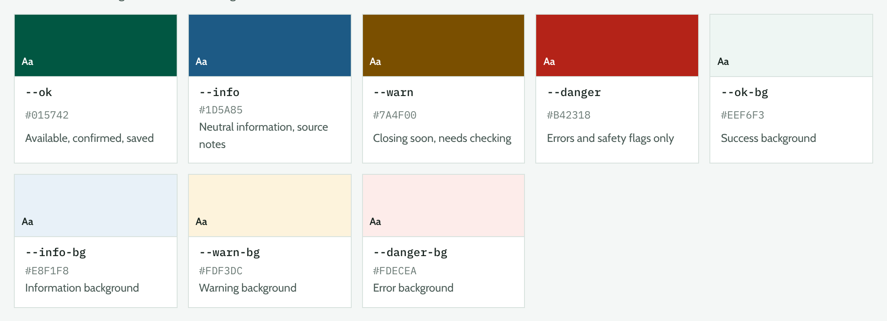

### Contrast

Text needs 4.5:1 against its background; borders of fields and buttons need 3:1 (WCAG 1.4.11).

| Pair | Light | Dark |
|---|---|---|
| `--ink` on `--canvas` | 15.0:1 | 15.2:1 |
| `--ink-2` on `--surface` | 7.2:1 | 8.0:1 |
| `--ink-3` on `--surface` | 4.5:1 | 5.8:1 |
| `--accent-text` on `--surface` | 5.3:1 | 8.9:1 |
| `--on-accent` on `--accent` | 8.6:1 | 8.0:1 |
| `--line-strong` on `--surface` | 3.5:1 | 3.5:1 |
| `--warn` on `--warn-bg` | 6.5:1 | 9.2:1 |
| `--danger` on `--danger-bg` | 5.7:1 | 7.8:1 |
| `--info` on `--info-bg` | 6.4:1 | 8.3:1 |

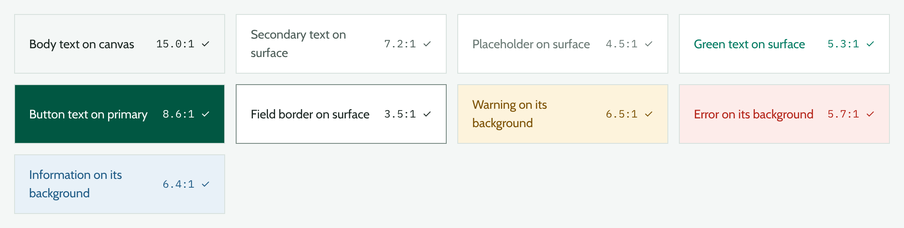

## 3. Typography

| Role | Face | Token | Use |
|---|---|---|---|
| Interface | Cabin 400 / 500 / 600 | `--font-ui` | Everything. 400 text, 500 labels inside running text, 600 headings, field labels and buttons. 700 is not used. |
| Data | IBM Plex Mono 400 / 500 | `--font-data` | Personal identity codes, booking references and codes only. Never prose or headings. |
| Wordmark | The Seasons Bold | `--font-mark` | "Psyykkeri" in the top bar and nothing else. Licensed, not committed (see README.md); falls back to Georgia. |

```css
--font-ui: 'Cabin', system-ui, -apple-system, 'Segoe UI', sans-serif;
--font-data: 'IBM Plex Mono', ui-monospace, 'SF Mono', Menlo, monospace;
--font-mark: 'The Seasons', Georgia, 'Times New Roman', serif;
```

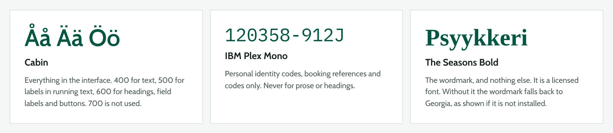

### Scale

| Token | Size / line height | Use |
|---|---|---|
| `--t-2xl` | 28 px / 1.25 | Page title (home, results) |
| `--t-xl` | 22 px / 1.25 | Section title |
| `--t-lg` | 18 px / 1.3 | Card title |
| `--t-md` | 16 px / 1.5 | Body, field input, dialog title |
| `--t-base` | 14 px / 1.5 | Buttons, labels, card facts, tables |
| `--t-sm` | 13 px / 1.45 | Hints, tags, status chips, status bar |
| `--t-xs` | 12 px / 1.4 | Uppercase table heads, map legend |

Nothing goes below 12 px. The map legend (now 10.4 px) and contact labels (now 10.9 px) move up to `--t-xs`. Uppercase labels get `letter-spacing: 0.06em`. Times, dates and distances use `font-variant-numeric: tabular-nums`.

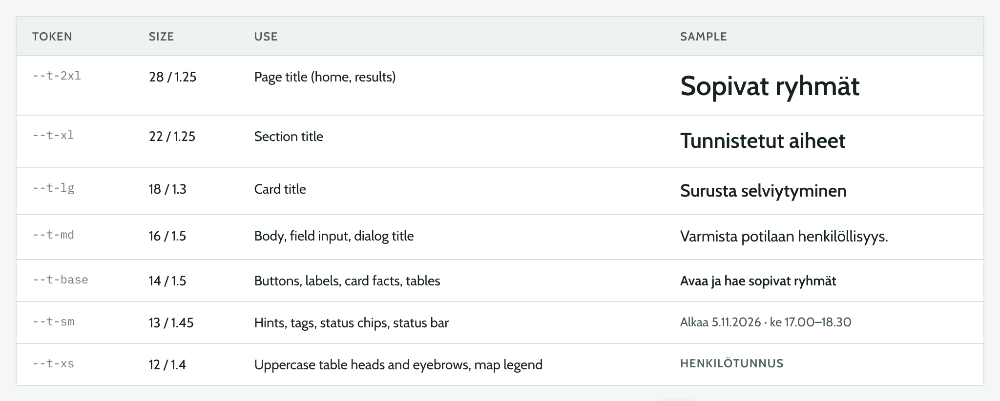

### Long words

Finnish and Swedish compounds outgrow narrow columns. Set `lang` on the root element to the UI language and use `hyphens: auto`. Browsers do not all ship Finnish hyphenation, so put soft hyphens (`&shy;`, `­` in `i18n.ts`) at the joins of long fixed terms. Never clip a word with an ellipsis, except the organisation name in the status bar on narrow screens.

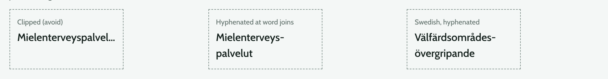

## 4. Space, shape and depth

### Spacing

A 4 px grid.

| Token | Value | Use |
|---|---|---|
| `--s1` | 4 px | Inside components |
| `--s2` | 8 px | Inside components |
| `--s3` | 12 px | Inside components, chip rows |
| `--s4` | 16 px | Between components, side gutter |
| `--s6` | 24 px | Between components, card and dialog padding |
| `--s8` | 32 px | Around page blocks |
| `--s12` | 48 px | Between page sections |

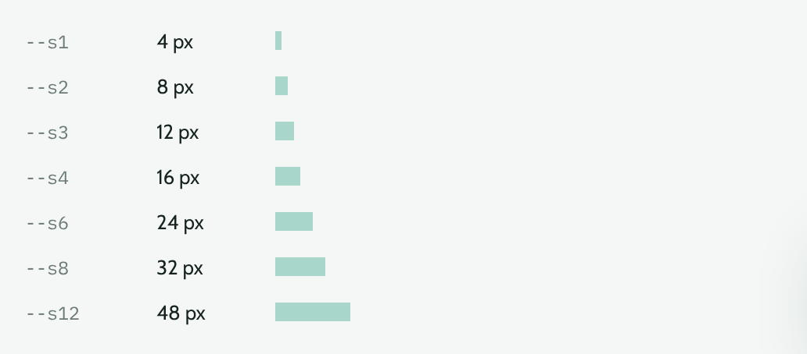

### Shape

- **Square corners everywhere** (`border-radius: 0`). The only exception is the small loading spinner.
- **The slant is the brand mark.** Buttons keep the straight left edge and slanted right edge, `|Varaa paikka/`, with `--slant: 0.5rem`. The language switch keeps its joined parallelograms, `|FI/ /SV/ /EN/`. Nothing else is angled.
- **One accent stripe:** the 4 px left stripe on group cards, where its colour means availability. Summary, contact, news and gallery boxes lose theirs.
- **One accent rule:** the 3 px `--rule` line under the top bar and on top of dialogs and the enlarged map.

### Depth

Two levels and no more. No gradients, highlight lines, frosted glass or glows.

```css
--shadow-1: 0 1px 2px rgb(1 37 28 / 0.06), 0 6px 16px -10px rgb(1 37 28 / 0.22); /* raised: cards, panels, filters, map panel */
--shadow-2: 0 24px 56px -20px rgb(1 37 28 / 0.45);                                /* overlay: dialogs, enlarged map, mobile menu */
```

Level 0 (sunken) is a flat `--sunken` fill with no shadow: disabled fields, dialog footers, table heads, the status bar.

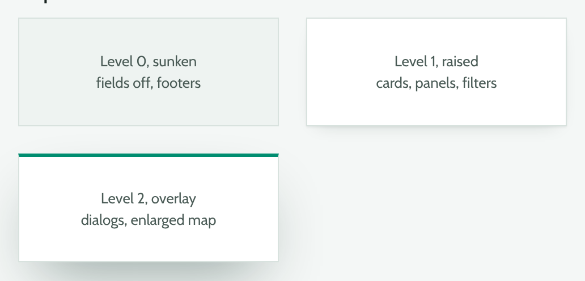

## 5. Components

Class names stay as in `src/styles.css` and `design/`; only their styling changes.

### Buttons (`.primary`, `.secondary`, `.link`, `.segment`)

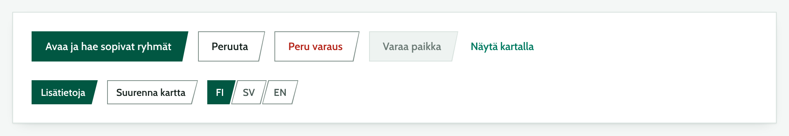

Dark theme:

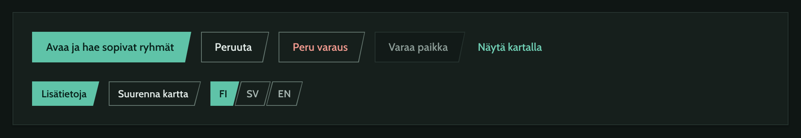

- Fills are flat: `.primary` is `--accent` with `--on-accent` text, hover `--accent-hover`. `.secondary` is `--surface` with a `--line-strong` border, hover border `--accent`.
- Height 40 px (32 px for small buttons in cards and the map), text `--t-base` at 600.
- One primary button per view region or dialog. In a row of actions it goes last, on the right.
- Labels are verbs that say what happens: "Varaa paikka", not "OK".
- A destructive action is a secondary button with `--danger` text. It is never primary.
- Disabled: `--sunken` fill, `--line` border, `--ink-3` text, `cursor: not-allowed`. No opacity fade.
- Focus: a 3 px `--focus` ring drawn by the `::before` layer, so it follows the slant.
- The active language segment is filled `--accent`; the others are secondary.

### Fields

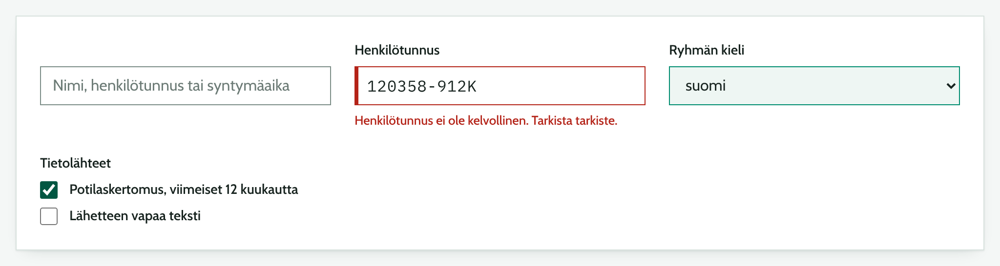

- A label above every field, `--t-base` at 600. The patient search is the one exception: a single field whose label is visually hidden (see `style.md`).
- Inputs: 40 px tall, 1 px `--line-strong` border, `--surface` fill, no inset shadow. Hover border `--ink-2`; focus 2 px `--focus` outline.
- Placeholders give an example in `--ink-3`, never the instruction.
- Errors: the message under the field in `--danger`, the field border `--danger` plus a 3 px inner left edge, and `aria-invalid` with `aria-describedby`.
- Suggested from the record (`.suggested`): `--rule` border and `--tint` fill. The evidence sentence stays in the `title` tooltip.
- Personal identity codes are typed in `--font-data`.
- Checkboxes: native, `accent-color: var(--accent)`, 18 px.

### Status chips and topic tags

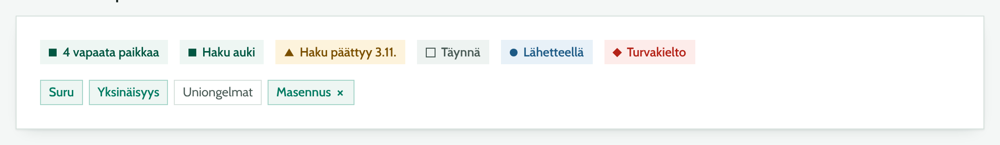

| State | Class | Colour | Marker | Example |
|---|---|---|---|---|
| Available | `.status.ok` | `--ok` on `--ok-bg` | filled square | 4 vapaata paikkaa, Haku auki |
| Closing soon | `.status.warn` | `--warn` on `--warn-bg` | triangle | Haku päättyy 3.11. |
| Unavailable | `.status.none` | `--ink-2` on `--sunken` | hollow square | Täynnä, Ilmoittautuminen päättynyt |
| Information | `.status.info` | `--info` on `--info-bg` | circle | Lähetteellä |
| Danger | `.status.danger` | `--danger` on `--danger-bg` | diamond | Turvakielto |

- The markers are small CSS shapes, so status never relies on colour alone. They are not emoji or pictograms.
- `.seats` uses these classes; a full group uses `.status.none`, not `--danger`.
- Topic tags: matched tags are `--accent-text` on `--tint` with an `--accent-soft` border, weight 600; other tags are `--ink-2` with a `--line` border. Topics are plain nouns with an initial capital, no `#`.

### Notices

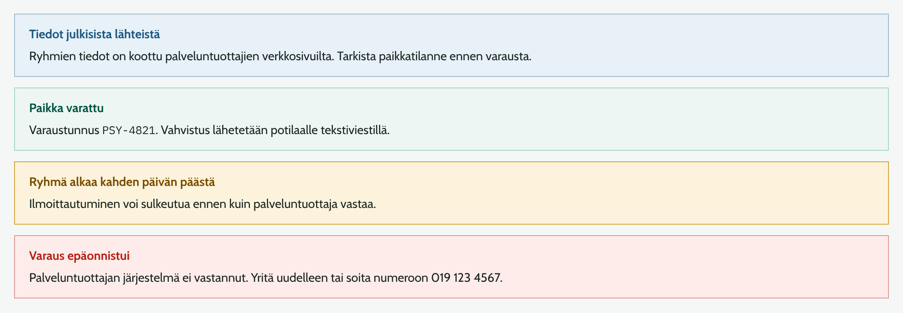

A 1 px border in the status colour, the status background, a bold title in the status colour and body text in `--ink`. No icons. Use `role="alert"` only for errors, `role="status"` for confirmations. An error says what failed and what to do next.

### Group card (`.card`)

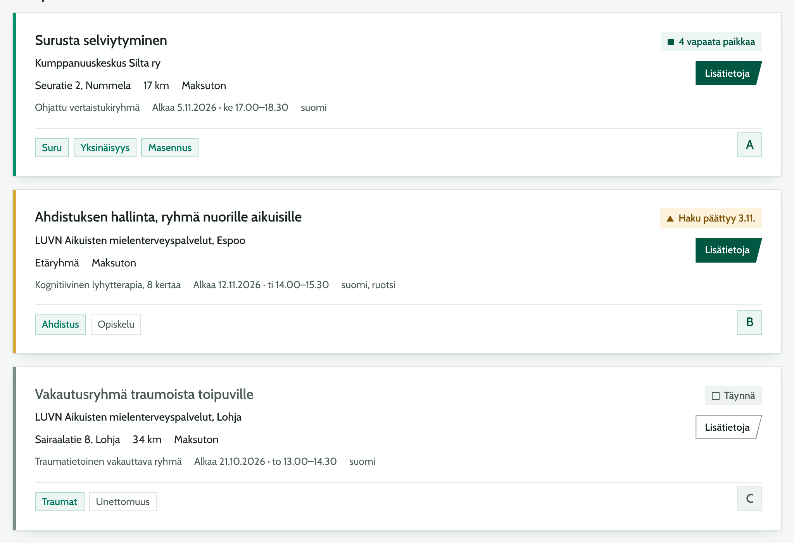

Dark theme:

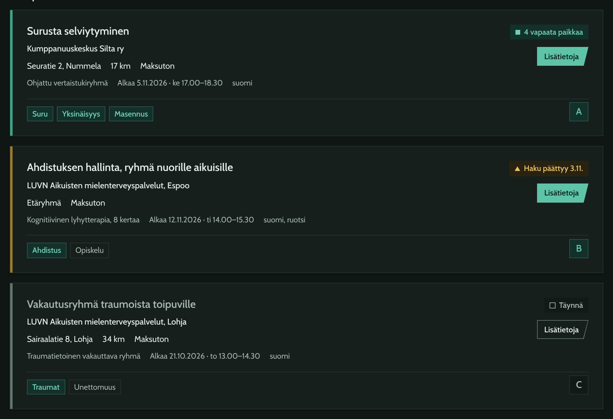

- The left stripe (`box-shadow: inset 4px 0 0 var(--avail)`) encodes availability: `--rule` open, `--warn-line` closing soon, `--line-strong` full.
- Title `--t-lg`, organiser `--t-base` at 500, facts `--t-base`, secondary facts `--t-sm` in `--ink-2`.
- Tags run across the full width under a `--line` divider.
- The rank letter (`.card-rank`) stays in the bottom right corner because it matches the map pin. It becomes a flat square: `--accent` text on `--tint`, `--accent-soft` border; grey on full groups.
- A full group keeps its details readable (no opacity fade). Its title turns `--ink-2` and its button becomes secondary.
- The active card (hovered or picked on the map) gets a 1 px `--accent-soft` outline and a `--tint` fill, without a gradient.
- Map pins follow the same rule: `--accent` square with white text, `--line-strong` for full, `--rule` and larger when active. No gradients.

### Dialog (`.modal`, `.titlebar`)

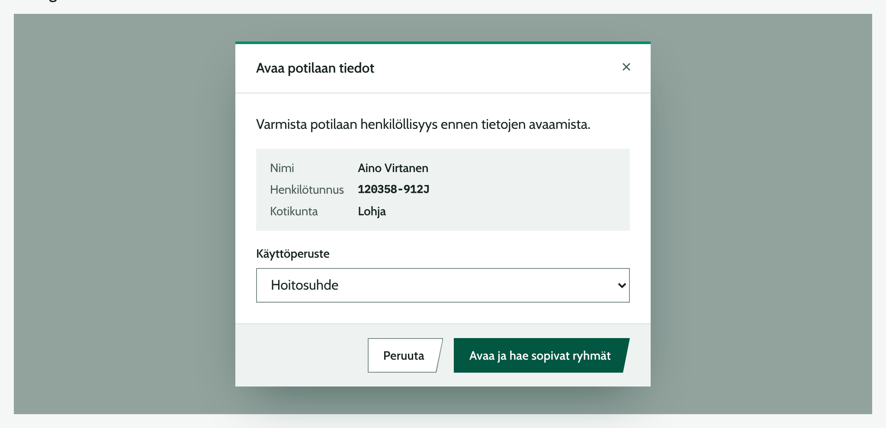

- `--surface`, 3 px `--rule` top border, `--shadow-2`, over a `--scrim` backdrop.
- The title bar is flat: `--t-md` title at 600 in `--ink`, a `--line` divider, and a 32 px close button that shows `--sunken` on hover.
- Actions sit in a footer with a `--sunken` fill and a `--line` top border, so they stay in place while the body scrolls. Cancel first, the primary action last.
- The identity box (`.identity`) uses `--sunken`; identity codes use `--font-data`.

### Patient banner (`.patient-banner`)

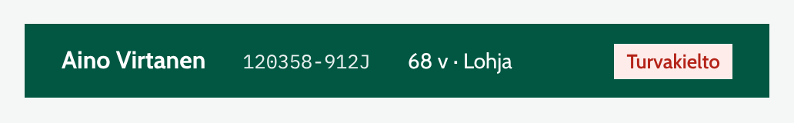

One flat `--accent` band with `--on-accent` text. Name at `--t-md` 600, identity code in `--font-data`. A non-disclosure flag sits at the right end as a danger chip.

### Status bar (`.statusbar`)

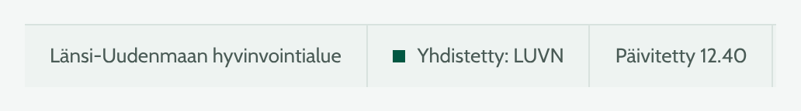

`--sunken` fill, `--line` top border and dividers, `--t-sm` text in `--ink-2`. The connection light is a plain 8 px `--ok` square without glow.

### Processing (`.processing`)

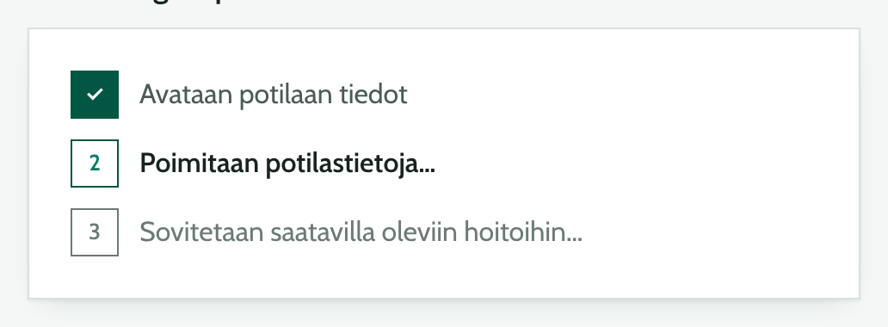

The steps sit on a `--surface` panel instead of the dark green radial gradient, so the main flow does not jump from light to dark and back. Done steps are filled `--accent`; the active step is `--ink` at 600; pending steps are `--ink-3`. The wave lines can stay, stroked in `--accent-soft`. Rotating phrases are `--ink-2`. Reduced-motion behaviour is unchanged.

### Tables (`.results-table`)

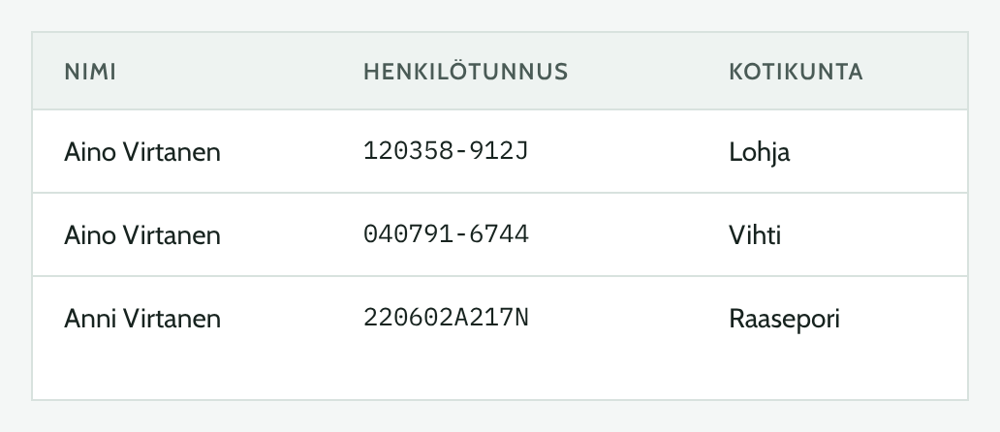

Head row on `--sunken`, `--t-xs` uppercase in `--ink-2`. Rows divided by `--line`; hover and keyboard focus show `--tint`. Identity codes in `--font-data`.

## 6. Voice and language

Write like a colleague who keeps good records: short, factual and neutral. The clinician is the expert; the app reports what it found and where. The three languages say the same thing, and each sounds native. All UI text comes from `src/i18n.ts` (see the language rule in `style.md`).

### Rules

- **Sentence case** everywhere, including buttons and headings. Uppercase only for table heads.
- **No exclamation marks, no emoji, no praise.** Confirmations state the fact: "Paikka varattu".
- **Address the clinician without pronouns** where Finnish allows it ("Tarkista tarkiste"). Swedish uses *du* only when a sentence needs a subject; English uses the imperative.
- **Say where data came from.** Anything inferred from the record carries its evidence in a tooltip.
- **Errors say what happened and what to do next**, without apology or blame.
- **Finland-Swedish and British English.** Use official names: "Västra Nylands välfärdsområde", "Western Uusimaa Wellbeing Services County".
- **No AI framing.** The app suggests groups; it does not "recommend" them "for you".

### Terms

The Finnish strings currently mix *asiakas* (2 strings) and *potilas* (9 strings), and the Swedish ones *klient* and *patient*. Use one term per concept.

| Concept | Suomi | Svenska | English | Note |
|---|---|---|---|---|
| The person being referred | potilas | patient | patient | Matches the record the data comes from. *Asiakas* only inside legal names, such as asiakastietolaki. |
| Treatment group | ryhmä | grupp | group | Not *kurssi* or *palvelu* in results. |
| Topic found in the record | aihe | tema | topic | Not *diagnoosi*; the app does not diagnose. |
| Enrolment state | ilmoittautuminen | anmälan | registration | Wording from `t.enrolment`. |
| Personal identity code | henkilötunnus | personbeteckning | personal identity code | Spell out in labels. *Hetu* only in code and notes. |
| Non-disclosure | turvakielto | spärrmarkering | non-disclosure | Always in the danger style. |

### Formats

Formatting follows the locales `fi-FI`, `sv-FI` and `en-GB`.

| What | Suomi | Svenska | English |
|---|---|---|---|
| Date | 5.11.2026 | 5.11.2026 | 5 Nov 2026 |
| Weekday and time | ke 17.00–18.30 | ons kl. 17.00–18.30 | Wed 17:00–18:30 |
| Distance | 17 km | 17 km | 17 km |
| Fee | Maksuton · 10 € | Avgiftsfri · 10 € | Free · €10 |
| Phone | 019 123 4567 | 019 123 4567 | +358 19 123 4567 |
| Age | 68 v | 68 år | 68 y |

Use a non-breaking space between a number and its unit, and an en dash (–) in ranges.

### Examples

| Write | Avoid | Why |
|---|---|---|
| FI: Ei ryhmiä valituilla suodattimilla. Poista jokin suodatin. | FI: Hups! Mitään ei löytynyt | States the result and the next step. |
| SV: Ogiltig personbeteckning. Kontrollera kontrolltecknet. | EN: Oops, something went wrong. Please try again later. | Names the field and the fix. |
| FI: Varaus epäonnistui. Palveluntuottajan järjestelmä ei vastannut. Yritä uudelleen tai soita numeroon 019 123 4567. | FI: Virhe 503 | Says what failed and gives a way forward. |
| FI: Sopivat ryhmät | FI: Tekoäly suosittelee näitä ryhmiä sinulle | Keeps the clinician's judgement first. |

## 7. What changes from the current stylesheet

Each row can land in `src/styles.css` on its own.

| Area | Now (`style.md`) | Target | Why |
|---|---|---|---|
| Colour tokens | 3 greens plus about 15 hex values inside rules | Role tokens above, each with a dark value | One place to change; dark theme for free |
| Green text | `#008d70` used for some text (4.2:1) | `--accent-text` `#007a61` (5.3:1); `#008d70` only as `--rule` and `--focus` | WCAG AA for small text |
| Placeholders | `#8a9893` (3.0:1) | `--ink-3` `#6b7a75` (4.5:1) | Readable examples |
| Field borders | `#d3e2dd` (1.3:1) | `--line-strong` (3.5:1) | Fields look like fields |
| Depth | Windows 7 / OS X feel: gradients on buttons, title bars, banner, rank squares and pins; highlight lines; frosted top bar; glowing status light | Flat fills, `--shadow-1` and `--shadow-2` only; top bar solid `--surface` | Calmer and more clinical. This reverses the depth section of `style.md` on purpose. |
| Type sizes | 13 sizes, 10.4–28 px | 7 sizes, 12–28 px | Clear hierarchy, nothing too small |
| Identifiers | System monospace, rarely | IBM Plex Mono for every identity code and reference | Digits are easy to check |
| Full groups | `--danger` "Täynnä" | `.status.none`, grey | Red is for errors and safety |
| Status set | Danger only | Ok, info, warning, unavailable, danger, each with a marker shape | Covers closing-soon and referral-only without colour alone |
| Accent stripes | Cards, summary, contact, news, gallery | Group cards only, coloured by availability | A stripe that means something |
| Rank letter | Gradient square with highlight | Flat tinted square, grey when full | Same link to the map, less weight |
| Processing | White on a dark green radial gradient | Steps on a light panel | No light-dark-light jump |
| Terms | *asiakas* and *potilas* mixed | *potilas* / *patient* throughout | Consistency in all three languages |

**Kept:** Cabin, the pine green family, square corners, the slanted button and language switch, the 3 px rule under the top bar, the doctor cat in the top bar, The Seasons for the wordmark, and every content and layout rule in `style.md`.

## 8. Rules for agents

When you change styles or components:

1. Use role tokens from section 2. Do not write hex, `rgb()` or named colours in component rules.
2. Use the type tokens from section 3 and the spacing tokens from section 4. No sizes outside the scale.
3. No gradients, highlight lines, `backdrop-filter` or glows. Depth is `--shadow-1` or `--shadow-2`.
4. Never show status by colour alone; use a status class with its marker and a word.
5. Use `--danger` only for errors, safety flags and destructive actions.
6. Keep `border-radius: 0` and the button slant. Do not add new angled or rounded shapes.
7. All UI text goes through `src/i18n.ts` in FI, SV and EN, following section 6.
8. When a change moves the app toward this guide, update `style.md` and the matching file in `design/` in the same change. If you regenerate an image here, render it from the same component markup.
